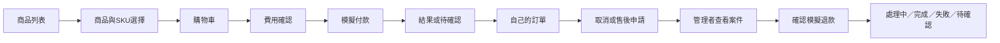

# 本機 mock 展示：畫面與操作規劃

日期：2026-10-13｜READY_FOR_REVIEW｜規劃提案，非已實作／驗收

來源：[現行政策](../../proposals/kohami/04-demo-commerce-policy.md)、[產品計畫](PRODUCT_PLAN.md)、[API](API_SPEC.md)、[資料與狀態](DOMAIN_MODEL.md)。既有 SCR-01–09 保留；子畫面使用字尾，沒有另造重複編號。

## 1. 旅程與交付範圍

本輪只規劃本機完整核心展示。全站常駐「展示環境，無實際交易」提示；TWD、語系及目前身份清楚可見。首頁直接提供商品入口，訪客不必登入才可瀏覽／結帳。換裝 SCR-07 與收藏詳細操作留後續，未就緒時顯示照片／尺寸表，不提供假換裝資格。

此箭頭是畫面入口，不是無條件狀態轉移；伺服器決定可操作項。取消、出貨、退款、憑證與驗收分開顯示。

## 2. 頁面責任與 API 追蹤

語系前綴 `/zh-TW`、`/ja`、`/en`；下表路由省略前綴。切換語言保留 cart、SKU、checkout 操作識別，不重建交易。商品未有某語翻譯時明示 fallback，不假稱完整三語內容。

| 畫面 ID／路由 | 內容與主要操作 | 必要空白／錯誤狀態 | OP |
| --- | --- | --- | --- |
| SCR-01 `/` | 品牌示意、商品入口、展示標示 | 圖片失敗有替代文字與可用入口 | OP-01 |
| SCR-02 `/products` | 搜尋、顏色／尺寸／可售篩選、商品卡 | 無結果提供清除篩選；失敗可重試 | OP-01 |
| SCR-03 `/products/:slug` | 合法示意照片、材質、量測、SKU、價格、庫存；明確選顏色／尺寸才加車 | 缺貨不可加車；下架不改歷史訂單；不相容換裝用備援 | OP-02、04 |
| SCR-04A `/cart` | 項目、數量、移除、單一優惠碼、進入結帳 | 空車有回商品入口；庫存變動逐項提示 | OP-03–05 |
| SCR-04B `/checkout` | 訪客聯絡／模擬配送資訊、示意運費及完整總額；一次確認 | 價格／庫存／費用失效保留輸入、重新確認；不直接多扣款 | OP-06–07 |
| SCR-05A `/checkout/:id` | 原費用快照、15分鐘到期時間、模擬付款操作與結果 | 待確認不提供再次付款；已到期仍可看查核狀態 | OP-08–09 |
| SCR-05B `/orders/:id` | 原單明細、付款、配送、退款與憑證分區；取消／售後入口 | 查閱無權／過期驗證不洩漏該單是否存在 | OP-10–14 |
| SCR-06A `/account/login` | 註冊、Email驗證、登入、忘記密碼；允許密碼管理器／貼上 | 統一登入錯誤、限流及過期驗證提示 | OP-15–20 |
| SCR-06B `/account/orders` | 本人訂單、帳號狀態、登出；收藏未交付明示 | 無訂單；不自動收編同Email訪客歷史訂單 | OP-10、20、38–40 |
| SCR-08A `/order-lookup` | 訂單識別＋Email申請；驗證後限單筆查詢 | 統一受理文字，過期／重送舊連結失效 | OP-21–22 |
| SCR-08B `/support`、`/policies` | 售後入口、展示條款、資料用途；不承諾真實配送／退款 | 提交失敗保留表單；沒有附件／本人照片上傳 | OP-13、40、42、46 |
| SCR-09A `/admin/login` | 管理帳號登入、MFA、近期重新驗證 | 未完成MFA不能進入後台；復原不是單封Email撤MFA | OP-17–19、23、41、43–44 |
| SCR-09B `/admin/orders/:id` | 案件必要資訊、付款／配送／退貨歷程、取消衝突、可退額 | 受限資料遮罩；無案件權限無資料 | OP-24–25 |
| SCR-09C `/admin/refunds/:id` | 金額、品項、原運費、原因、既有退款與未知保留；確認模擬退款 | MFA過期先驗證；版本衝突重新載入、不自動重送新操作 | OP-26–28 |
| SCR-09D `/admin/fulfillment/:id` | 模擬出貨、配送進度、退回與Inspection | 未付／取消不可出貨；不提供任意status輸入 | OP-29–30、37 |
| SCR-09E `/admin/catalog` | 商品三語內容、SKU／示意價、庫存、運費版本 | 草稿不可售；缺翻譯有發布檢查；影響快照提醒 | OP-31–33 |
| SCR-09F `/admin/audit`、`/admin/demo` | 只讀稽核、mock情境／台帳、隔離通知與重設入口 | 控制權限不足禁止；不含秘密；重設不是一鍵刪庫 | OP-34–36、45 |
| SCR-06C `/account/profile` | 改Email／資料權利請求與主動歸戶；敏感變更重新驗證 | 過期／原單已屬他人不歸戶；刪除留必要證據理由 | OP-38–40 |
| SCR-09G `/admin/access` | 合成帳號、角色範圍及起迄、授予／撤銷 | 舊版本／近期MFA失效拒絕；無共享最高帳號 | OP-23、41 |
| SCR-09H `/admin/support` | 指派案件、退貨受理／收件、文字回覆、資料權利處置 | 不藉案件入口越權退款／取得私人收藏 | OP-37、40、42 |

## 3. 關鍵互動線框（文字版）

商品頁：麵包屑 → 商品圖／替代文字 → 商品名稱與TWD價 → 顏色 → 衣服尺碼 → 庫存／量測入口 → 加入購物車。手機依同序排列；底部購買列不得遮焦點、錯誤或展示標示。

結帳頁：購物車摘要 → 身份／聯絡 → 模擬配送 → 示意費用 → 總額與到期規則 →「確認並開始模擬付款」。桌面右側摘要，手機置於確認按鈕前；不以預選會員／隱藏運費縮短流程。

管理退款：原單／模式與狀態 → 可退商品／數量 → 商品實付分攤與運費 → 已完成／處理中／待確認退款 → 原因 → 可退總額 →「確認模擬退款」對話框。確認後立刻顯示原操作處理中；失去連線以同操作查詢，不換新識別。伺服器回錯時保留理由但重新取版本與可退額。

## 4. 狀態文案與可及性

| 原因 | 顧客 zh-TW／ja／en 文案草案 | 動作 |
| --- | --- | --- |
| 付款未知 | 模擬付款待確認／模擬決済の確認待ち／Simulated payment pending confirmation | 查看同筆結果，禁止再付 |
| 保留到期 | 庫存保留已到期／在庫の確保期限が切れました／Inventory reservation expired | 原單查核；另購先重新確認 |
| 退款成功 | 模擬退款完成，無實際入帳／模擬返金完了。実際の入金はありません／Simulated refund completed; no funds transferred | 顯示原幣別金額與明細 |
| 退款未知 | 模擬退款待確認／模擬返金の確認待ち／Simulated refund pending confirmation | 保留案件與下一步 |
| 費用失效 | 費用已更新，請重新確認／料金が更新されました。再確認してください／Costs changed; please review again | 不直接確認新總額 |

翻譯是工程審閱草案，正式對外文案需人工校對；不可因切語系改變金額或狀態。所有異步狀態有文字和適當live region，不只用色；表單有label、欄位及總結錯誤；對話框管理焦點，關閉回原按鈕；動態結果不搶焦點。付款前完整確認可返回修改。15分鐘保留倒數先告知，不以無障礙設計暗中延長交易期限，逾時保留非敏感表單並可重新確認；可及性相容性須檢查，不能僅因本規則固定就宣稱WCAG符合。

UX驗收：逐頁鍵盤操作、手機320/390 CSS px、桌面1440 CSS px、200%縮放、400% reflow、螢幕閱讀器關鍵流程、載入／斷線／重送／權限撤銷。完整矩陣見 [品質與交付](IMPLEMENTATION_PLAN.md)。

## M1具體線框與內容詳規

新增[商品到費用確認詳規](M1_CATALOG_PLAN.md)、[三語內容](CONTENT_LOCALE_CONTRACT.md)。SCR-03桌面[SVG](wireframes/M1-product-desktop.svg)／[PNG](wireframes/M1-product-desktop.png)，SCR-04A手機[SVG](wireframes/M1-cart-mobile.svg)／[PNG](wireframes/M1-cart-mobile.png)。它們是靜態審閱稿：商品圖為中性占位、SKU為明確選定後狀態、按鈕不執行交易，實際布局／可及性／互動仍須產品驗收。

## M2結果／訂單與存取入口

SCR-04B/05A/05B/06B/08A見[M2詳規](M2_CHECKOUT_ORDER_PLAN.md)。手機SCR-05B[SVG](wireframes/M2-order-status-mobile.svg)／[PNG](wireframes/M2-order-status-mobile.png)為已驗證單筆guest.read且付款Unknown案例，取消按鈕只導向重新驗證，沒有直接執行動作。初次checkout.read不應看到同樣完整Order明細；兩種畫面資料範圍不同。線框是假資料／靜態，不是產品查閱或無障礙通過。

## M3 SCR-09C/D/H管理工作台補充（提案）

[桌面退款線框](wireframes/M3-admin-refund-desktop.png)顯示原實收1590／已退552／Unknown553／可用485，本案只選符合資格425；單獨顯示額外來源補償，不混入原商品。SCR-09C確認前顯示來源／原單位／運費資格／mock提示與近期MFA；未決不提供同目的再退款。SCR-09D區分Return收件／Inspection／唯一入庫，SCR-09H呈現各來源差異／憑證未決與下一步，Unknown不能硬結案。顧客狀態顯示退款完成但憑證仍處理中等獨立結果。線框是靜態圖，角色與MFA標示不是已實作。詳[M3流程](M3_AFTERCARE_REFUND_PLAN.md)。
