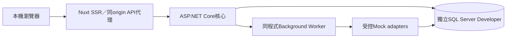

# 本機完整 mock：技術架構與信任邊界

> **現行 MFA 決議（2026-10-13）：** 使用者明確「先採用B」，第一版後台採 Email／密碼＋驗證器 TOTP，Passkey 留後續。下文先前「待決／Passkey優先」是歷史狀態，已由此決議取代。方案選擇阻擋已解除；註冊／proof／復原機器契約與產品實證仍待完成，不能標為 PASS。詳見 [身份詳規](AUTH_SECURITY_PROFILE.md)。

日期：2026-10-13｜READY_FOR_REVIEW｜框架已採用，以下部署／身份細節為提案

## 1. 已知與建議

已採 ASP.NET Core／.NET 10、Vue 3／Nuxt SSR、Microsoft SQL Server；已有獨立SQL Developer容器與17個純規則實驗測試。本輪不再選語言／框架，不重建SQL環境。第一版使用者已確認「先本機完整展示」，不規劃付費或可分享的外網站台。

建議單一ASP.NET商務核心＋同程式受控background worker、Nuxt SSR程序、既有SQL容器；Catalog／Inventory／Checkout／Order／Payment／Fulfillment／Identity／Content只是程式邏輯模組，不拆微服務。維持[ADR-0002](../../adr/0002-dotnet-vue-sqlserver.md)的EF Core SQL Server工程預設。

箭頭為資料責任示意，mock adapter不自行繞過應用寫入交易；其結果返回應用command／事件處理，由同一規則更新SQL。

## 2. 程序與身份方案提案

- Nuxt處理SSR、路由／三語／互動、cookie的同origin API轉送；後端擁有交易與授權判斷。SSR private fetch只轉送當前請求必要session，不共用會員payload cache，不把secret或驗證token序列化到HTML。
- 候選ASP.NET Core Identity＋EF Core管理Email／密碼雜湊、驗證及session；後台MFA優先評估具使用者驗證Passkey，若本地整合成本／支援不足提出TOTP備案，不默默繞過已採MFA或以Email第二因子代替。此次不宣稱已選完MFA套件／已驗證身份。
- Cookie session＋antiforgery，guest單筆查詢及動作驗證分開；後台退款近期MFA5分鐘、閒置15分鐘／最長8小時沿用政策建議值，正式數值依採用記錄固定。共享身份庫可以，後台需獨立MFA權限閘門，不因member登入取得後台。
- Background worker與outbox持久化，不引入Redis／Kafka／獨立佇列主機；多worker／重啟同樣靠SQL claim／去重與版本，不能依單process記憶體鎖保證一致性。
- 流程成功／未知／失敗由允許情境與操作識別控制。API／DB／worker測試真實資料流程；外部adapter才是mock。

## 3. 本機網路、資料與設定

僅loopback；SQL沿用127.0.0.1:14333及受限kohami_test DB登入，密碼僅讀被ignore且0600的本地設定，不進示例／日誌。Nuxt與API候選port3000/5000，啟動前檢查衝突；URL/port集中設定，不隨處硬編。Secure cookie本機使用受信任local HTTPS開發入口；建立／信任憑證屬後續實作步驟，不在本輪執行或要求瀏覽器忽略憑證錯誤。

Mode與dataset使用環境固定allowlist，啟動時偵測非mock配置／真實供應商credentials就拒絕運行本展示，不能切換成正式交易。Demo DB資料以DatasetId隔離；未確認資料集不能重設。現有KohamiTest暫無產品schema，後續migration／seed版本可重建，但不執行drop整個SQL或刪volume。

dev account只合成人格，授權可重建且秘密另注入；禁止正式PII、付款秘密、本人照片／AI呼叫、行銷追蹤。對外網路只限明確開發依賴／合法素材來源的準備，不在商務mock runtime呼叫第三方。

## 4. 可觀測、故障與恢復

健康：live只確認process；ready確認SQL及schema版本，不公開credential／資料。結構化日誌以traceId、dataset、operation、mode與錯誤code關聯；不記完整request／SQL參數／token／地址。Audit獨立日常只讀，拒絕及撤權留痕。

本機管理頁顯示pending outbox、unknown付款／退款、到期保留、失敗憑證與對帳差異；unknown一直是待確認，不用重試上限轉成功／失敗。使用可控clock驗證重啟跨15分鐘邊界、訊息至少一次、雙worker、交易rollback。

備份與restore規劃使用指定mock DB／資料集，在獨立restore目標演練，不覆寫正在使用的資料。還原後重套刪除／限制及去重紀錄，對账未決額度／庫存；已完成事件不再次收款／退款。既有SQL容器graceful restart smoke不是產品災難復原。

## 5. 邊界與後續採用

物理Schema、API/OpenAPI、MFA機制、HTTPS工具及視覺tokens在這份審閱包屬提案；採用後依旅程實證。正式主機／SQL授權、真金流／物流／發票、通知渠道與資金退款授權制度延期。SQL ARM/Rosetta僅本地開發結果，正式支援x64驗證不由此推定。

本規劃不鎖定Nuxt／EF patch、第三方元件或代碼生成器；實作時依官方受支援版本及相容性固定lockfile／SDK，避免提案變成未檢查的版本承諾。

## 官方參考（2026-10-13核對）

[ASP.NET Core Identity](https://learn.microsoft.com/en-us/aspnet/core/security/authentication/identity?view=aspnetcore-10.0)作帳號／角色／驗證候選依據；[TOTP設定](https://learn.microsoft.com/en-us/aspnet/core/security/authentication/identity-enable-qrcodes?view=aspnetcore-10.0)是備案實證參考，不代表已選用；[CSRF防護](https://learn.microsoft.com/en-us/aspnet/core/security/anti-request-forgery?view=aspnetcore-10.0)用於cookie信任邊界；[EF Core競爭](https://learn.microsoft.com/en-us/ef/core/saving/concurrency)不能取代業務交易／唯一約束。此方案推論須經本機M0實證，不能直接照模板宣稱適用Nuxt整體部署。

## M0身份查核更新

官方 .NET10 Passkey僅提供primary authentication，未內建second-factor流程。新增[身份詳規](AUTH_SECURITY_PROFILE.md)分開應用MFA gate提案與原生能力；本輪Passkey優先／TOTP選擇尚待回覆，不鎖定或默認降級。候選密碼stage＋Passkey proof要核對同帳號／UV／origin，或依人類選擇採TOTP實證；沒有新登入／資料表程式。
