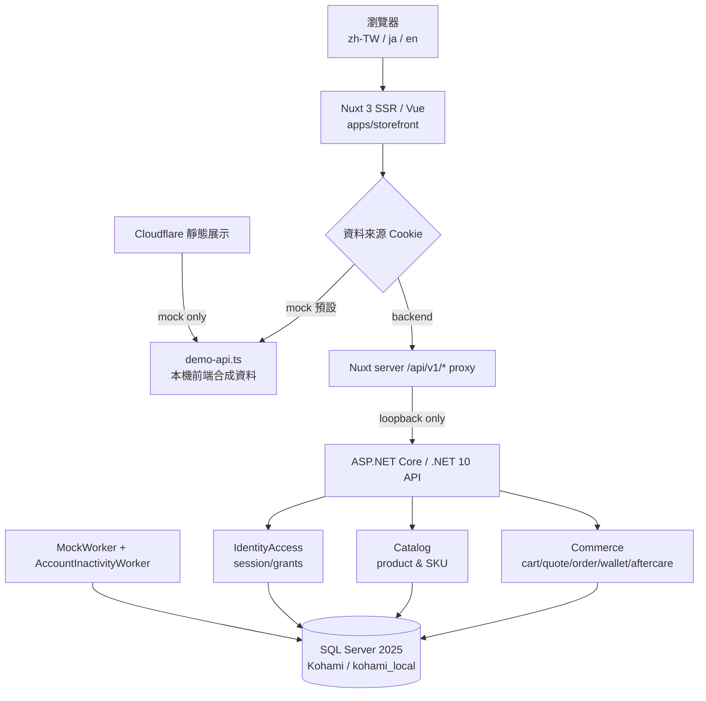
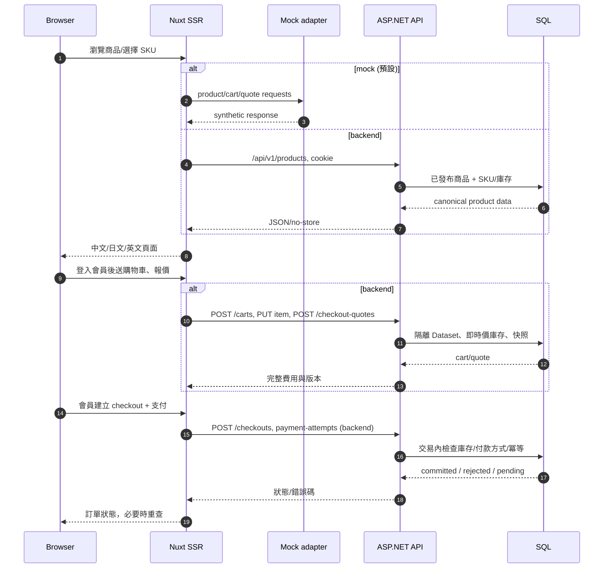
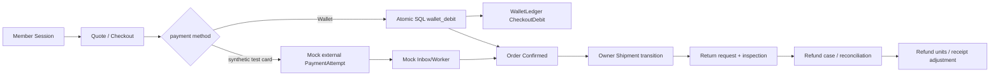

# KOHAMI 現行架構、資料流與交互邊界

> `main@0d54903e`；來源：`apps/api/Program.cs`、`apps/storefront/nuxt.config.ts`、`server/api/v1/[...path].ts`、`src/Modules/**`、`infra/kohami-sql/compose.yaml`。**架構圖是程式關係示意，不代表部署在公網。**

## 1. 系統與執行模式

- **前台**：Nuxt SSR、Vue；主要路由 `/zh-TW`、`/ja`、`/en`，頁面首頁、商品詳情、Cart、Checkout、Account/Registration、Wallet、Policies、Support、管理者商品/報表等。
- **資料切換**：`useDataSource()` 的 `kohami.data-source` cookie 預設 `mock`；`createDataSourceFetch()` 導向 `demo-api.ts` 或 `useStorefrontApi` 的 proxy。不是兩個完整獨立後端；mock 模式不打真 API/SQL。
- **後端**：ASP.NET Core 本機 loopback（5080–5099）；模組化單體 `IdentityAccess/Catalog/Commerce`，以 SQL Server 交易維持資金/庫存/狀態一致。其他 `Fitting/Fulfillment/CustomerCare` 大部分為接口/規劃，不可憑目錄名稱推定已完成。
- **worker**：與 API 共用資料庫，負責排程工作、mock 狀態推進/資料清理；維護 gate 與 lease/fencing 須守住。
- **環境**：本機 `kohami-sql` SQL Server 2025 Developer，`Kohami` DB，`kohami_local` dataset；Cloudflare public-demo 現階段只供純靜態 mock 展示。`NUXT_API_ORIGIN` 代理只接受 loopback，非安全的公開後端部署設定。

## 2. 顧客資料流

> 注意：mock 分支不應繼續打 backend；上圖末段專門描繪 backend 情境。新建訂單要求會員登入，訪客歷史訂單的 proof/capability 路徑是向後相容。

## 3. 金流與售後資料流（目前全部模擬）

- **Wallet**：`GET /wallet/current` 讀本人，`POST /wallet/top-ups` 驗證合成卡並走 `wallet_mock_credit`，`POST /admin/wallet-credits` 受 user.manage 控制；餘額扣抵 SQL transaction + ledger 具有已有測試證據，不等於正式退款可用。現行 `Refund` 明確拒絕 Wallet collection `WALLET_REFUND_UNSUPPORTED`。
- **Card**：mock event 的 processing/succeeded/failed/unknown/late，靠可信內部訊號/Worker 更正；不可把 POST 202 當金流成功。
- **預留**：cart 不是庫存預留；quote 檢價，checkout 建立 held reservation，成功/失敗/超時按交易流程轉移；不能任意覆蓋已確認快照。
- **退款**：退款 case/operation/units 分開；不得只改訂單狀態，原 collection 額度+shipping slot+重播都須檢查。
- **權限**：後台 scope/RBAC，會員個資只供本人；寫入須同源+CSRF、cookie、冪等/預期版本。訪客舊單能力單次/短效。

## 4. 模組與 repo 導覽

| 目錄 | 核心責任 | 主要 source |
|---|---|---|
| `apps/storefront/app/pages` | SSR routes/頁面呈現與操作 | `index.vue`, `cart.vue`, `checkout/[id].vue`, `wallet.vue`, `account.vue` |
| `apps/storefront/app/utils/demo-api.ts` | 不用網路的 mock request/response | `data-source-fetch.ts`, `useDataSource.ts` |
| `apps/storefront/server/api/v1/[...path].ts` | 僅 loopback 的受限代理 | headers allowlist、max body、no-store |
| `apps/api/Program.cs` | host、middleware、CSRF、runtime request/response guard、module registration | Core.openapi.json |
| `src/Modules/IdentityAccess` | 帳號/session/角色/scope | `SecurityEndpoints.cs`, `SecurityService.cs` |
| `src/Modules/Catalog` | 商品發佈、SKU、讀取 | `CatalogEndpoints.cs`, Catalog schema |
| `src/Modules/Commerce` | 交易、wallet、aftercare、reconciliation | `CommerceEndpoints.cs`, Commerce schema |
| `tools/native-operations` | migration、Owner 初始化/復原等原生限制操作 | `migrations/0016..` |
| `tests/`、`apps/storefront/tests/` | .NET、SQL、Playwright、本機 acceptance | runner/fixtures 經驗證 |

## 5. 必要不變量及失敗恢復

1. **不可跨資料集**：所有持久化讀寫僅對授權 `kohami_local`，維持 UserId/Owner scope；跨會員請求拒絕而且不寫入。
2. **不可重扣**：每筆寫入 operation key + request hash + SQL transaction；同 key 同 payload 重送返回原回應，不同 payload 明確衝突。
3. **不可超賣／超退**：以 row lock / stock reservation / collection/refund unit 交易約束，所有失敗場景不能留下部分狀態。
4. **未知不是成功也不是失敗**：使用既有查詢/人工 reconciliation，禁止自動重試真資金結果。
5. **不能以 UI 狀態取代 API 真相**：換資料源時重置頁面狀態/認證與 Query Cache，使用後端回覆為準。
6. **公開 demo 不等於 production**：不接真金流、不輸出秘密、禁本機 DB 對外曝露；正式上線須另外批准。
