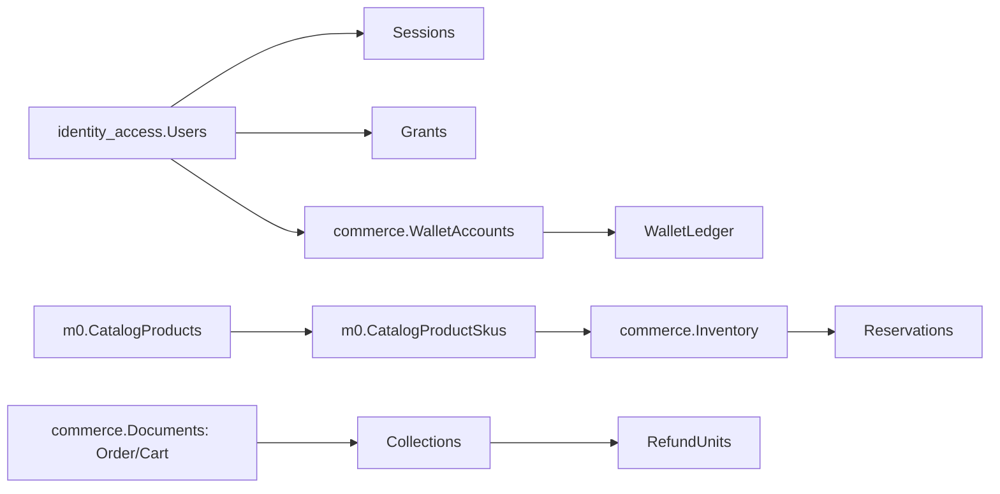

# KOHAMI SQL Server：物理表／欄位字典（DDL 推導）

> 基準 `main@0d54903e`；**靜態 schema盤點，未連線讀取資料庫 `sys.tables/sys.columns`，因此不宣稱每個本機實例已完成所有 migrations**。表欄由 `CREATE TABLE`、明確 `ALTER TABLE ADD` 的來源整理，遇到其他 migration 實際套用差異需以資料庫 introspection 比對。本文件共 30 張建表定義，含既有過渡表；來源路徑逐表保留，沒有臆造正式資料庫內容。

## 資料庫／容器／schema

- **本機主要容器**：`infra/kohami-sql/compose.yaml`，專案名 `kohami-sql`，Microsoft SQL Server 2025 Developer，loopback `127.0.0.1:14349`，volume `kohami-sql_data`，獨立 backup/TLS volumes。
- **現行工作資料庫**：`Kohami`；dedicated 合成資料集 `kohami_local`。正式資料庫不存在可信部署證據。歷史 `KohamiM0`、`KohamiTest`、`demo_m0` 是舊腳本／fixture，**不可直接當作新環境目標**。
- **現行 schema**：`identity_access`（帳戶／授權）、`commerce`（交易／錢包）、`m0`（catalog 原始建表可能仍保留；**其現行落點需讀取 live sys.schemas**）、`ops`（原生受控操作）。`0016_kohami_identity_and_dataset_rename.sql` 將 `m0 → identity_access`、`m0commerce → commerce` 並將資料集值 `demo_m0 → kohami_local`；執行後應以實際 schema 為準，不能在變更前盲目重跑 DDL。
- **不是多資料庫商務分離**：主要設計為同一 SQL Server DB 內以 schema／Dataset 分界。無 MongoDB／PostgreSQL／Redis 正式部署的程式證據。

## 約束與操作注意

- 資料庫金額為 **TWD 整數（bigint）**，不得用浮點加總；庫存與餘額具非負約束。Snapshot JSON（`Documents.Body`、商品 `DraftJson/PublicJson`）欄位內的子物件需另以 schema／API 定義解釋，**不等於每個 JSON key 是獨立 SQL 欄**。
- 多表以 `Dataset` 及業務 ID 複合主鍵隔離，必須維持 transaction、owner scope、unique source、idempotency 與索引約束；`WalletLedger` 不得直接由公開 API 手動修改。
- **正式確認前必跑唯讀 introspection**：`SELECT TABLE_SCHEMA,TABLE_NAME FROM INFORMATION_SCHEMA.TABLES WHERE TABLE_TYPE='BASE TABLE';`、`SELECT TABLE_SCHEMA,TABLE_NAME,COLUMN_NAME,DATA_TYPE,IS_NULLABLE,ORDINAL_POSITION FROM INFORMATION_SCHEMA.COLUMNS ORDER BY TABLE_SCHEMA,TABLE_NAME,ORDINAL_POSITION;`，另查 `sys.key_constraints`、`sys.foreign_keys`、`sys.check_constraints`、migration ledger。此文件為宣告 DDL 的明細，不是實際 `Kohami` live schema dump。

## 資料關聯圖（概念）

> 上圖概念關聯不保證實體 FK 全部存在，尤其 JSON Documents 內的業務關聯。

## 各表欄位

### `commerce.Collections`（10 欄）

**用途**：商務訂單、資金、庫存或背景工作；**DDL 來源**：`src/Modules/Commerce/Infrastructure/Persistence/CommerceSchema.sql`。原始腳本可能使用 `m0commerce` schema，須依 migration 0016 對應。

| 欄位 | SQL 型別 | 限制摘要 | 用途 |
|---|---|---|---|
| `Dataset` | `varchar(30)` | NOT NULL CHECK(Dataset='demo_m0') | 資料集隔離識別：現行 dedicated fixture 應為 kohami_local |
| `Id` | `varchar(100)` | NOT NULL | 資料列識別碼 |
| `OrderId` | `varchar(100)` | NOT NULL | 訂單識別碼 |
| `Kind` | `varchar(10)` | NOT NULL CHECK(Kind IN ('Primary','Late','Extra')) | 識別分類、顯示屬性或規格 |
| `Collected` | `bigint ` | NOT NULL CHECK(Collected>0) | 已收款金額（整數） |
| `Pending` | `bigint ` | NOT NULL DEFAULT 0 | 退款待處理金額 |
| `Refunded` | `bigint ` | NOT NULL DEFAULT 0 | 已退款金額 |
| `ShippingPaid` | `bigint ` | NOT NULL DEFAULT 0 | 已收運費 |
| `ShippingSlot` | `varchar(15)` | NOT NULL DEFAULT 'Free' CHECK(ShippingSlot IN ('Free','Processing','Unknown','Succeeded')) | 運費退款狀態槽 |
| `PaymentMethod` | `varchar(20)` | NOT NULL DEFAULT 'ExternalMock' CHECK('ExternalMock'\|'Wallet')（wallet migration） | 付款管道：ExternalMock/Wallet |

### `commerce.Documents`（6 欄）

**用途**：商務訂單、資金、庫存或背景工作；**DDL 來源**：`src/Modules/Commerce/Infrastructure/Persistence/CommerceSchema.sql`。原始腳本可能使用 `m0commerce` schema，須依 migration 0016 對應。

| 欄位 | SQL 型別 | 限制摘要 | 用途 |
|---|---|---|---|
| `Dataset` | `varchar(30)` | NOT NULL CHECK(Dataset='demo_m0') | 資料集隔離識別：現行 dedicated fixture 應為 kohami_local |
| `Kind` | `varchar(30)` | NOT NULL | 識別分類、顯示屬性或規格 |
| `Id` | `varchar(100)` | NOT NULL | 資料列識別碼 |
| `OwnerId` | `varchar(150)` | NOT NULL | 關聯目標或業務識別碼 |
| `Version` | `bigint ` | NOT NULL CHECK(Version>0) | 樂觀鎖版本／資料版本 |
| `Body` | `nvarchar(max)` | NOT NULL CHECK(ISJSON(Body)=1) | JSON 序列化資料內容 |

### `commerce.GuestCapabilities`（8 欄）

**用途**：商務訂單、資金、庫存或背景工作；**DDL 來源**：`src/Modules/Commerce/Infrastructure/Persistence/CommerceSchema.sql`。原始腳本可能使用 `m0commerce` schema，須依 migration 0016 對應。

| 欄位 | SQL 型別 | 限制摘要 | 用途 |
|---|---|---|---|
| `Dataset` | `varchar(30)` | NOT NULL CHECK(Dataset='demo_m0') | 資料集隔離識別：現行 dedicated fixture 應為 kohami_local |
| `Id` | `varchar(100)` | NOT NULL | 資料列識別碼 |
| `OrderId` | `varchar(100)` | NOT NULL | 訂單識別碼 |
| `BrowserId` | `varchar(150)` | NOT NULL | 識別訪客瀏覽器 |
| `Intent` | `varchar(10)` | NOT NULL CHECK(Intent IN ('read','cancel','return','claim')) | 操作意圖（read/cancel/return/claim） |
| `ExpiresAt` | `datetimeoffset ` | NOT NULL | 有效期限／過期時間 |
| `Consumed` | `bit ` | NOT NULL DEFAULT 0 | 能力是否已被消耗 |
| `OperationKey` | `varchar(160)` | NULL | 冪等操作識別鍵 |

### `commerce.GuestRequests`（10 欄）

**用途**：商務訂單、資金、庫存或背景工作；**DDL 來源**：`src/Modules/Commerce/Infrastructure/Persistence/CommerceSchema.sql`。原始腳本可能使用 `m0commerce` schema，須依 migration 0016 對應。

| 欄位 | SQL 型別 | 限制摘要 | 用途 |
|---|---|---|---|
| `Dataset` | `varchar(30)` | NOT NULL CHECK(Dataset='demo_m0') | 資料集隔離識別：現行 dedicated fixture 應為 kohami_local |
| `Id` | `varchar(100)` | NOT NULL | 資料列識別碼 |
| `OrderId` | `varchar(100)` | NOT NULL | 訂單識別碼 |
| `BrowserId` | `varchar(150)` | NOT NULL | 識別訪客瀏覽器 |
| `Intent` | `varchar(10)` | NOT NULL CHECK(Intent IN ('read','cancel','return','claim')) | 操作意圖（read/cancel/return/claim） |
| `NonceHash` | `char(64)` | NOT NULL | 單次挑戰 nonce 雜湊 |
| `ProofHash` | `char(64)` | NOT NULL | 驗證證據雜湊 |
| `ExpiresAt` | `datetimeoffset ` | NOT NULL | 有效期限／過期時間 |
| `Used` | `bit ` | NOT NULL DEFAULT 0 | 單次驗證是否已使用 |
| `Matched` | `bit ` | NOT NULL | 驗證是否成功匹配 |

### `commerce.Idempotency`（8 欄）

**用途**：商務訂單、資金、庫存或背景工作；**DDL 來源**：`src/Modules/Commerce/Infrastructure/Persistence/CommerceSchema.sql`。原始腳本可能使用 `m0commerce` schema，須依 migration 0016 對應。

| 欄位 | SQL 型別 | 限制摘要 | 用途 |
|---|---|---|---|
| `Dataset` | `varchar(30)` | NOT NULL CHECK(Dataset='demo_m0') | 資料集隔離識別：現行 dedicated fixture 應為 kohami_local |
| `Actor` | `varchar(150)` | NOT NULL | 執行者識別碼 |
| `Scope` | `varchar(200)` | NOT NULL | 識別分類、顯示屬性或規格 |
| `OperationKey` | `varchar(160)` | NOT NULL | 冪等操作識別鍵 |
| `RequestHash` | `char(64)` | NOT NULL | 冪等請求 payload 摘要 |
| `Response` | `nvarchar(max)` | NOT NULL CHECK(ISJSON(Response)=1) | 冪等結果快照 JSON |
| `StatusCode` | `int ` | NOT NULL | 首次操作 HTTP 狀態碼 |
| `Version` | `bigint ` | NULL | 樂觀鎖版本／資料版本 |

### `commerce.Inbox`（6 欄）

**用途**：商務訂單、資金、庫存或背景工作；**DDL 來源**：`src/Modules/Commerce/Infrastructure/Persistence/CommerceSchema.sql`。原始腳本可能使用 `m0commerce` schema，須依 migration 0016 對應。

| 欄位 | SQL 型別 | 限制摘要 | 用途 |
|---|---|---|---|
| `Dataset` | `varchar(30)` | NOT NULL CHECK(Dataset='demo_m0') | 資料集隔離識別：現行 dedicated fixture 應為 kohami_local |
| `EventId` | `varchar(100)` | NOT NULL | 關聯目標或業務識別碼 |
| `SourceId` | `varchar(100)` | NOT NULL | 唯一來源事件 ID，防重 |
| `PayloadHash` | `char(64)` | NOT NULL | 雜湊／內容指紋；不應儲存明文 |
| `Body` | `nvarchar(max)` | NOT NULL CHECK(ISJSON(Body)=1) | JSON 序列化資料內容 |
| `Applied` | `bit ` | NOT NULL DEFAULT 0 | 儲存 Applied；業務語意需依操作流程與 SQL constraints 核驗 |

### `commerce.Inventory`（5 欄）

**用途**：商務訂單、資金、庫存或背景工作；**DDL 來源**：`src/Modules/Commerce/Infrastructure/Persistence/CommerceSchema.sql`。原始腳本可能使用 `m0commerce` schema，須依 migration 0016 對應。

| 欄位 | SQL 型別 | 限制摘要 | 用途 |
|---|---|---|---|
| `Dataset` | `varchar(30)` | NOT NULL CHECK(Dataset='demo_m0') | 資料集隔離識別：現行 dedicated fixture 應為 kohami_local |
| `Sku` | `varchar(100)` | NOT NULL | SKU 識別碼 |
| `Price` | `bigint ` | NOT NULL CHECK(Price>=0) | SKU 交易價格（TWD 整數） |
| `Stock` | `int ` | NOT NULL CHECK(Stock>=0) | 可供管理的庫存數量 |
| `Active` | `bit ` | NOT NULL DEFAULT 1 | 狀態或開關旗標 |

### `commerce.Jobs`（15 欄）

**用途**：商務訂單、資金、庫存或背景工作；**DDL 來源**：`src/Modules/Commerce/Infrastructure/Persistence/CommerceSchema.sql`。原始腳本可能使用 `m0commerce` schema，須依 migration 0016 對應。

| 欄位 | SQL 型別 | 限制摘要 | 用途 |
|---|---|---|---|
| `Dataset` | `varchar(30)` | NOT NULL CHECK(Dataset='demo_m0') | 資料集隔離識別：現行 dedicated fixture 應為 kohami_local |
| `Id` | `varchar(100)` | NOT NULL | 資料列識別碼 |
| `Kind` | `varchar(30)` | NOT NULL | 識別分類、顯示屬性或規格 |
| `TargetId` | `varchar(100)` | NOT NULL | 關聯目標或業務識別碼 |
| `Actor` | `varchar(150)` | NOT NULL | 執行者識別碼 |
| `SecurityVersion` | `bigint ` | NOT NULL | 身分安全版本，用於撤權與 session 失效 |
| `Permission` | `varchar(80)` | NULL | 操作權限名稱 |
| `ResourceKind` | `varchar(50)` | NOT NULL | 識別分類、顯示屬性或規格 |
| `ResourceId` | `varchar(100)` | NOT NULL | 關聯目標或業務識別碼 |
| `State` | `varchar(15)` | NOT NULL CHECK(State IN ('NotStarted','Started','Completed','Blocked')) | 工作、預留、入金或退貨狀態 |
| `LeaseOwner` | `varchar(100)` | NULL | 背景工作租約持有者 |
| `LeaseUntil` | `datetimeoffset ` | NULL | 租約期限 |
| `Fence` | `bigint ` | NOT NULL DEFAULT 0 | 防止舊 worker 重複提交之 fencing token |
| `Payload` | `nvarchar(max)` | NOT NULL CHECK(ISJSON(Payload)=1) | JSON 工作 payload |
| `CreatedAt` | `datetimeoffset ` | NOT NULL | 建立時間 |

### `commerce.PrivateDeliveries`（4 欄）

**用途**：商務訂單、資金、庫存或背景工作；**DDL 來源**：`src/Modules/Commerce/Infrastructure/Persistence/CommerceSchema.sql`。原始腳本可能使用 `m0commerce` schema，須依 migration 0016 對應。

| 欄位 | SQL 型別 | 限制摘要 | 用途 |
|---|---|---|---|
| `Dataset` | `varchar(30)` | NOT NULL CHECK(Dataset='demo_m0') | 資料集隔離識別：現行 dedicated fixture 應為 kohami_local |
| `Id` | `varchar(100)` | NOT NULL | 資料列識別碼 |
| `RequestId` | `varchar(100)` | NOT NULL | 關聯目標或業務識別碼 |
| `ProtectedProof` | `nvarchar(max)` | NOT NULL | 保護過的訪客證據，不可對外揭露 |

### `commerce.RefundUnits`（9 欄）

**用途**：商務訂單、資金、庫存或背景工作；**DDL 來源**：`src/Modules/Commerce/Infrastructure/Persistence/CommerceSchema.sql`。原始腳本可能使用 `m0commerce` schema，須依 migration 0016 對應。

| 欄位 | SQL 型別 | 限制摘要 | 用途 |
|---|---|---|---|
| `Dataset` | `varchar(30)` | NOT NULL CHECK(Dataset='demo_m0') | 資料集隔離識別：現行 dedicated fixture 應為 kohami_local |
| `UnitId` | `varchar(100)` | NOT NULL | 關聯目標或業務識別碼 |
| `OrderId` | `varchar(100)` | NOT NULL | 訂單識別碼 |
| `LineId` | `varchar(100)` | NOT NULL | 訂單明細識別碼 |
| `CollectionId` | `varchar(100)` | NOT NULL | 關聯目標或業務識別碼 |
| `Ordinal` | `int ` | NOT NULL CHECK(Ordinal>=0) | 訂單細項內序號 |
| `Paid` | `bigint ` | NOT NULL CHECK(Paid>=0) | 分配至退款單位的原支付金額 |
| `Slot` | `varchar(15)` | NOT NULL DEFAULT 'Free' CHECK(Slot IN ('Free','Processing','Unknown','Succeeded')) | 退款資金狀態槽 |
| `OperationId` | `varchar(100)` | NULL | 操作識別碼 |

### `commerce.ReportAccessAudit`（7 欄）

**用途**：商務訂單、資金、庫存或背景工作；**DDL 來源**：`src/Modules/Commerce/Infrastructure/Persistence/Issue23RetentionMigration.sql`。原始腳本可能使用 `m0commerce` schema，須依 migration 0016 對應。

| 欄位 | SQL 型別 | 限制摘要 | 用途 |
|---|---|---|---|
| `Id` | `bigint ` | IDENTITY NOT NULL PRIMARY KEY | 資料列識別碼 |
| `Dataset` | `varchar(30)` | NOT NULL CHECK(Dataset='demo_m0') | 資料集隔離識別：現行 dedicated fixture 應為 kohami_local |
| `ActorUserId` | `nvarchar(100)` | NULL | 關聯目標或業務識別碼 |
| `RequestedAt` | `datetimeoffset ` | NOT NULL | 時間戳／期限 |
| `AuthorizationOutcome` | `varchar(10)` | NOT NULL CHECK(AuthorizationOutcome IN ('Authorized','Denied')) | 儲存 AuthorizationOutcome；業務語意需依操作流程與 SQL constraints 核驗 |
| `FromDate` | `date ` | NULL | 時間戳／期限 |
| `ToDate` | `date ` | NULL | 時間戳／期限 |

### `commerce.Reservations`（6 欄）

**用途**：商務訂單、資金、庫存或背景工作；**DDL 來源**：`src/Modules/Commerce/Infrastructure/Persistence/CommerceSchema.sql`。原始腳本可能使用 `m0commerce` schema，須依 migration 0016 對應。

| 欄位 | SQL 型別 | 限制摘要 | 用途 |
|---|---|---|---|
| `Dataset` | `varchar(30)` | NOT NULL CHECK(Dataset='demo_m0') | 資料集隔離識別：現行 dedicated fixture 應為 kohami_local |
| `OrderId` | `varchar(100)` | NOT NULL | 訂單識別碼 |
| `Sku` | `varchar(100)` | NOT NULL | SKU 識別碼 |
| `Quantity` | `int ` | NOT NULL CHECK(Quantity>0) | 數量 |
| `State` | `varchar(10)` | NOT NULL CHECK(State IN ('Held','Released','Consumed')) | 工作、預留、入金或退貨狀態 |
| `ExpiresAt` | `datetimeoffset ` | NOT NULL | 有效期限／過期時間 |

### `commerce.WalletAccounts`（5 欄）

**用途**：會員餘額／不可變帳本；**DDL 來源**：`src/Modules/Commerce/Infrastructure/Persistence/MemberWalletMigration.sql`。原始腳本可能使用 `m0commerce` schema，須依 migration 0016 對應。

| 欄位 | SQL 型別 | 限制摘要 | 用途 |
|---|---|---|---|
| `Dataset` | `varchar(30)` | NOT NULL CHECK(Dataset='demo_m0') | 資料集隔離識別：現行 dedicated fixture 應為 kohami_local |
| `UserId` | `nvarchar(100)` | NOT NULL | 會員／使用者識別碼 |
| `AvailableTwd` | `bigint ` | NOT NULL CHECK(AvailableTwd>=0) | 可用新台幣會員餘額（不可任意從 UI 更新） |
| `Version` | `bigint ` | NOT NULL CHECK(Version>0) | 樂觀鎖版本／資料版本 |
| `UpdatedAt` | `datetimeoffset ` | NOT NULL | 異動時間 |

### `commerce.WalletLedger`（10 欄）

**用途**：會員餘額／不可變帳本；**DDL 來源**：`src/Modules/Commerce/Infrastructure/Persistence/MemberWalletMigration.sql`。原始腳本可能使用 `m0commerce` schema，須依 migration 0016 對應。

| 欄位 | SQL 型別 | 限制摘要 | 用途 |
|---|---|---|---|
| `Dataset` | `varchar(30)` | NOT NULL CHECK(Dataset='demo_m0') | 資料集隔離識別：現行 dedicated fixture 應為 kohami_local |
| `EntryId` | `varchar(100)` | NOT NULL | 帳本流水識別碼 |
| `UserId` | `nvarchar(100)` | NOT NULL | 會員／使用者識別碼 |
| `EntryType` | `varchar(24)` | NOT NULL CHECK(EntryType IN ('SyntheticCredit','CheckoutDebit','RefundCredit')) | 帳本事件種類（合成入金／扣抵／退回） |
| `AmountTwd` | `bigint ` | NOT NULL CHECK(AmountTwd>0) | 帳本新台幣金額 |
| `Currency` | `char(3)` | NOT NULL CHECK(Currency='TWD') | ISO 4217 幣別，錢包限制 TWD |
| `SourceId` | `varchar(100)` | NOT NULL | 唯一來源事件 ID，防重 |
| `CreatedAt` | `datetimeoffset ` | NOT NULL | 建立時間 |
| `ActorId` | `nvarchar(100)` | NULL（0022） | 執行者 ID |
| `Reason` | `nvarchar(500)` | NULL（0022） | 異動理由供稽核 |

### `identity_access.AccountInactivityNotices`（8 欄）

**用途**：帳號／驗證／授權或資料生命週期；**DDL 來源**：`src/Modules/IdentityAccess/Infrastructure/Persistence/Issue23AccountInactivityMigration.sql`。原始腳本可能使用 `m0` schema，須依 migration 0016 對應。

| 欄位 | SQL 型別 | 限制摘要 | 用途 |
|---|---|---|---|
| `NoticeId` | `nvarchar(100)` | NOT NULL PRIMARY KEY | 關聯目標或業務識別碼 |
| `UserId` | `nvarchar(100)` | NOT NULL REFERENCES m0.Users(UserId) | 會員／使用者識別碼 |
| `ActivityAt` | `datetimeoffset ` | NOT NULL | 時間戳／期限 |
| `State` | `varchar(20)` | NOT NULL CHECK(State IN('Pending','Sending','Sent','Cancelled','Completed')) | 工作、預留、入金或退貨狀態 |
| `CreatedAt` | `datetimeoffset ` | NOT NULL | 建立時間 |
| `LeaseOwner` | `nvarchar(100)` | NULL | 背景工作租約持有者 |
| `LeaseUntil` | `datetimeoffset ` | NULL | 租約期限 |
| `SentAt` | `datetimeoffset ` | NULL | 時間戳／期限 |

### `identity_access.AuthFailures`（5 欄）

**用途**：帳號／驗證／授權或資料生命週期；**DDL 來源**：`src/Modules/IdentityAccess/Infrastructure/Persistence/PasswordOnlyAuthSchema.sql`。原始腳本可能使用 `m0` schema，須依 migration 0016 對應。

| 欄位 | SQL 型別 | 限制摘要 | 用途 |
|---|---|---|---|
| `Id` | `bigint ` | IDENTITY PRIMARY KEY | 資料列識別碼 |
| `AccountKey` | `varchar(64)` | NOT NULL | 儲存 AccountKey；業務語意需依操作流程與 SQL constraints 核驗 |
| `BrowserKey` | `varchar(64)` | NOT NULL | 儲存 BrowserKey；業務語意需依操作流程與 SQL constraints 核驗 |
| `IpKey` | `varchar(64)` | NOT NULL | 儲存 IpKey；業務語意需依操作流程與 SQL constraints 核驗 |
| `At` | `datetimeoffset ` | NOT NULL | 事件發生時間 |

### `identity_access.CatalogAuditEvents`（9 欄）

**用途**：商品主檔／SKU／發布稽核；**DDL 來源**：`src/Modules/Catalog/Infrastructure/Persistence/CatalogSchema.sql`。原始腳本可能使用 `m0` schema，須依 migration 0016 對應。

| 欄位 | SQL 型別 | 限制摘要 | 用途 |
|---|---|---|---|
| `Dataset` | `varchar(30)` | NOT NULL CHECK (Dataset='demo_m0') | 資料集隔離識別：現行 dedicated fixture 應為 kohami_local |
| `AuditId` | `varchar(100)` | NOT NULL | 關聯目標或業務識別碼 |
| `ProductId` | `varchar(100)` | NOT NULL | 商品主檔識別碼 |
| `ActorId` | `varchar(150)` | NOT NULL | 執行者 ID |
| `Action` | `varchar(40)` | NOT NULL CHECK (Action IN ('ProductCreated','ProductDraftUpdated','ProductPublished','ProductUn | 操作名稱 |
| `Outcome` | `varchar(20)` | NOT NULL CHECK (Outcome='Succeeded') | 儲存 Outcome；業務語意需依操作流程與 SQL constraints 核驗 |
| `Version` | `bigint ` | NOT NULL | 樂觀鎖版本／資料版本 |
| `At` | `datetimeoffset ` | NOT NULL | 事件發生時間 |
| `Details` | `nvarchar(max)` | NOT NULL CHECK (ISJSON(Details)=1) | JSON 快照或事件細節 |

### `identity_access.CatalogProducts`（12 欄）

**用途**：商品主檔／SKU／發布稽核；**DDL 來源**：`src/Modules/Catalog/Infrastructure/Persistence/CatalogSchema.sql`。原始腳本可能使用 `m0` schema，須依 migration 0016 對應。

| 欄位 | SQL 型別 | 限制摘要 | 用途 |
|---|---|---|---|
| `Dataset` | `varchar(30)` | NOT NULL CHECK (Dataset='demo_m0') | 資料集隔離識別：現行 dedicated fixture 應為 kohami_local |
| `ProductId` | `varchar(100)` | NOT NULL | 商品主檔識別碼 |
| `Slug` | `varchar(100)` | NOT NULL | 識別分類、顯示屬性或規格 |
| `PublicSlug` | `varchar(100)` | NULL | 識別分類、顯示屬性或規格 |
| `State` | `varchar(20)` | NOT NULL CHECK (State IN ('Draft','Published','Unpublished')) | 工作、預留、入金或退貨狀態 |
| `Version` | `bigint ` | NOT NULL CHECK (Version>0) | 樂觀鎖版本／資料版本 |
| `PublicRevision` | `varchar(100)` | NULL | 公開商品版本 |
| `DraftJson` | `nvarchar(max)` | NOT NULL CHECK (ISJSON(DraftJson)=1) | 未發布商品 JSON |
| `PublicJson` | `nvarchar(max)` | NULL CHECK (PublicJson IS NULL OR ISJSON(PublicJson)=1) | 已發布商品 JSON |
| `OwnerId` | `varchar(150)` | NOT NULL | 關聯目標或業務識別碼 |
| `CreatedAt` | `datetimeoffset ` | NOT NULL | 建立時間 |
| `UpdatedAt` | `datetimeoffset ` | NOT NULL | 異動時間 |

### `identity_access.CatalogProductSkus`（11 欄）

**用途**：商品主檔／SKU／發布稽核；**DDL 來源**：`src/Modules/Catalog/Infrastructure/Persistence/CatalogSchema.sql`。原始腳本可能使用 `m0` schema，須依 migration 0016 對應。

| 欄位 | SQL 型別 | 限制摘要 | 用途 |
|---|---|---|---|
| `Dataset` | `varchar(30)` | NOT NULL CHECK (Dataset='demo_m0') | 資料集隔離識別：現行 dedicated fixture 應為 kohami_local |
| `SkuId` | `varchar(100)` | NOT NULL | 販售 SKU 識別碼 |
| `ProductId` | `varchar(100)` | NOT NULL | 商品主檔識別碼 |
| `ColorId` | `varchar(80)` | NOT NULL | 關聯目標或業務識別碼 |
| `GarmentSize` | `varchar(40)` | NOT NULL | 識別分類、顯示屬性或規格 |
| `DraftPriceTwd` | `bigint ` | NOT NULL CHECK (DraftPriceTwd>0) | 草稿 SKU 新台幣價格 |
| `DraftActive` | `bit ` | NOT NULL | 狀態或開關旗標 |
| `DraftIncluded` | `bit ` | NOT NULL | 狀態或開關旗標 |
| `PublicPriceTwd` | `bigint ` | NULL CHECK (PublicPriceTwd IS NULL OR PublicPriceTwd>0) | 已發布 SKU 新台幣價格 |
| `PublicActive` | `bit ` | NULL | 狀態或開關旗標 |
| `PublicIncluded` | `bit ` | NOT NULL DEFAULT 0 | 狀態或開關旗標 |

### `identity_access.Challenges`（10 欄）

**用途**：帳號／驗證／授權或資料生命週期；**DDL 來源**：`src/Modules/IdentityAccess/Infrastructure/Persistence/PasswordOnlyAuthSchema.sql`。原始腳本可能使用 `m0` schema，須依 migration 0016 對應。

| 欄位 | SQL 型別 | 限制摘要 | 用途 |
|---|---|---|---|
| `ChallengeId` | `nvarchar(100)` | PRIMARY KEY | 關聯目標或業務識別碼 |
| `UserId` | `nvarchar(100)` | NOT NULL REFERENCES m0.Users(UserId) | 會員／使用者識別碼 |
| `SessionId` | `nvarchar(100)` | NOT NULL | 登入工作階段識別碼 |
| `Intent` | `varchar(40)` | NOT NULL | 操作意圖（read/cancel/return/claim） |
| `RequestNonce` | `nvarchar(160)` | NOT NULL | 要求 nonce，阻擋重播 |
| `ExpiresAt` | `datetimeoffset ` | NOT NULL | 有效期限／過期時間 |
| `SecurityVersion` | `bigint ` | NOT NULL | 身分安全版本，用於撤權與 session 失效 |
| `Attempts` | `int ` | NOT NULL DEFAULT 0 | 儲存 Attempts；業務語意需依操作流程與 SQL constraints 核驗 |
| `ConsumedAt` | `datetimeoffset ` | NULL | 消耗時間 |
| `ProofHash` | `varchar(64)` | NULL | 驗證證據雜湊 |

### `identity_access.Grants`（12 欄）

**用途**：帳號／驗證／授權或資料生命週期；**DDL 來源**：`src/Modules/IdentityAccess/Infrastructure/Persistence/PasswordOnlyAuthSchema.sql`。原始腳本可能使用 `m0` schema，須依 migration 0016 對應。

| 欄位 | SQL 型別 | 限制摘要 | 用途 |
|---|---|---|---|
| `GrantId` | `nvarchar(100)` | PRIMARY KEY | 授權紀錄識別碼 |
| `UserId` | `nvarchar(100)` | NOT NULL REFERENCES m0.Users(UserId) | 會員／使用者識別碼 |
| `Role` | `nvarchar(30)` | NOT NULL | 角色種類 |
| `Permission` | `nvarchar(100)` | NOT NULL | 操作權限名稱 |
| `ScopeKind` | `nvarchar(30)` | NOT NULL | 授權範圍類別 |
| `ScopeId` | `nvarchar(100)` | NOT NULL | 授權範圍 ID |
| `ValidFrom` | `datetimeoffset ` | NOT NULL | 授權起始時間 |
| `ValidUntil` | `datetimeoffset ` | NOT NULL | 授權結束時間 |
| `RevokedAt` | `datetimeoffset ` | NULL | 撤銷時間 |
| `Version` | `bigint ` | NOT NULL DEFAULT 1 | 樂觀鎖版本／資料版本 |
| `GrantedBy` | `nvarchar(100)` | NOT NULL | 儲存 GrantedBy；業務語意需依操作流程與 SQL constraints 核驗 |
| `Reason` | `nvarchar(500)` | NOT NULL | 異動理由供稽核 |

### `identity_access.MemberProfiles`（4 欄）

**用途**：帳號／驗證／授權或資料生命週期；**DDL 來源**：`tools/native-operations/migrations/0020_member_registration.sql`。原始腳本可能使用 `identity_access` schema，須依 migration 0016 對應。

| 欄位 | SQL 型別 | 限制摘要 | 用途 |
|---|---|---|---|
| `UserId` | `nvarchar(100)` | NOT NULL PRIMARY KEY CONSTRAINT FK_MemberProfiles_Users REFERENCES identity_access.Users(UserId | 會員／使用者識別碼 |
| `DisplayName` | `nvarchar(120)` | NULL | 識別分類、顯示屬性或規格 |
| `Phone` | `nvarchar(32)` | NULL | 儲存 Phone；業務語意需依操作流程與 SQL constraints 核驗 |
| `CreatedAt` | `datetimeoffset ` | NOT NULL CONSTRAINT DF_MemberProfiles_CreatedAt DEFAULT SYSUTCDATETIME() | 建立時間 |

### `identity_access.SecurityAudit`（6 欄）

**用途**：帳號／驗證／授權或資料生命週期；**DDL 來源**：`src/Modules/IdentityAccess/Infrastructure/Persistence/PasswordOnlyAuthSchema.sql`。原始腳本可能使用 `m0` schema，須依 migration 0016 對應。

| 欄位 | SQL 型別 | 限制摘要 | 用途 |
|---|---|---|---|
| `Id` | `bigint ` | IDENTITY PRIMARY KEY | 資料列識別碼 |
| `UserId` | `nvarchar(100)` | NOT NULL | 會員／使用者識別碼 |
| `Action` | `varchar(80)` | NOT NULL | 操作名稱 |
| `At` | `datetimeoffset ` | NOT NULL | 事件發生時間 |
| `OperationId` | `uniqueidentifier ` | NULL | 操作識別碼 |
| `SecurityVersion` | `bigint ` | NOT NULL | 身分安全版本，用於撤權與 session 失效 |

### `identity_access.SecurityReplays`（4 欄）

**用途**：帳號／驗證／授權或資料生命週期；**DDL 來源**：`src/Modules/IdentityAccess/Infrastructure/Persistence/PasswordOnlyAuthSchema.sql`。原始腳本可能使用 `m0` schema，須依 migration 0016 對應。

| 欄位 | SQL 型別 | 限制摘要 | 用途 |
|---|---|---|---|
| `Actor` | `nvarchar(100)` | NOT NULL | 執行者識別碼 |
| `BusinessKey` | `nvarchar(160)` | NOT NULL | 儲存 BusinessKey；業務語意需依操作流程與 SQL constraints 核驗 |
| `Fingerprint` | `varchar(64)` | NOT NULL | 內容指紋，用於拒絕不一致重放 |
| `At` | `datetimeoffset ` | NOT NULL | 事件發生時間 |

### `identity_access.SecurityState`（8 欄）

**用途**：帳號／驗證／授權或資料生命週期；**DDL 來源**：`src/Modules/IdentityAccess/Infrastructure/Persistence/PasswordOnlyAuthSchema.sql`。原始腳本可能使用 `m0` schema，須依 migration 0016 對應。

| 欄位 | SQL 型別 | 限制摘要 | 用途 |
|---|---|---|---|
| `Id` | `int ` | NOT NULL PRIMARY KEY CHECK(Id=1) | 資料列識別碼 |
| `Maintenance` | `bit ` | NOT NULL DEFAULT 1 | 維護模式旗標 |
| `OwnerPrepared` | `bit ` | NOT NULL DEFAULT 0 | Owner 初始化是否已準備 |
| `BootstrapActivated` | `bit ` | NOT NULL DEFAULT 0 | Owner 初始啟用旗標 |
| `BootstrapOperationId` | `uniqueidentifier ` | NULL | 關聯目標或業務識別碼 |
| `BootstrapUserId` | `nvarchar(100)` | NULL | 關聯目標或業務識別碼 |
| `MaintenanceTargetUserId` | `nvarchar(100)` | NULL | 關聯目標或業務識別碼 |
| `Epoch` | `bigint ` | NOT NULL DEFAULT 1 | 安全／授權世代 |

### `identity_access.Sessions`（9 欄）

**用途**：帳號／驗證／授權或資料生命週期；**DDL 來源**：`src/Modules/IdentityAccess/Infrastructure/Persistence/PasswordOnlyAuthSchema.sql`。原始腳本可能使用 `m0` schema，須依 migration 0016 對應。

| 欄位 | SQL 型別 | 限制摘要 | 用途 |
|---|---|---|---|
| `SessionId` | `nvarchar(100)` | PRIMARY KEY | 登入工作階段識別碼 |
| `UserId` | `nvarchar(100)` | NOT NULL REFERENCES m0.Users(UserId) | 會員／使用者識別碼 |
| `SecurityVersion` | `bigint ` | NOT NULL | 身分安全版本，用於撤權與 session 失效 |
| `Stage` | `varchar(40)` | NOT NULL CHECK(Stage IN('AdminAuthenticated','MemberAuthenticated')) | 登入驗證階段 |
| `ExpiresAt` | `datetimeoffset ` | NOT NULL | 有效期限／過期時間 |
| `AbsoluteUntil` | `datetimeoffset ` | NOT NULL | 工作階段硬期限 |
| `RequestNonce` | `nvarchar(160)` | NOT NULL | 要求 nonce，阻擋重播 |
| `AuthenticatedAt` | `datetimeoffset ` | NOT NULL | 登入時間 |
| `RevokedAt` | `datetimeoffset ` | NULL | 撤銷時間 |

### `identity_access.Users`（8 欄）

**用途**：帳號／驗證／授權或資料生命週期；**DDL 來源**：`src/Modules/IdentityAccess/Infrastructure/Persistence/PasswordOnlyAuthSchema.sql`。原始腳本可能使用 `m0` schema，須依 migration 0016 對應。

| 欄位 | SQL 型別 | 限制摘要 | 用途 |
|---|---|---|---|
| `UserId` | `nvarchar(100)` | PRIMARY KEY | 會員／使用者識別碼 |
| `Email` | `nvarchar(254)` | NOT NULL UNIQUE | 帳號電子郵件 |
| `PasswordHash` | `nvarchar(1000)` | NOT NULL | 密碼雜湊，不能還原或對外顯示 |
| `EmailConfirmed` | `bit ` | NOT NULL DEFAULT 0 | Email 已完成驗證旗標 |
| `SecurityHold` | `bit ` | NOT NULL DEFAULT 0 | 狀態或開關旗標 |
| `Status` | `varchar(30)` | NOT NULL CHECK(Status IN('Active','SetupOnly','Suspended','Closed')) | 業務／帳號狀態 |
| `SecurityVersion` | `bigint ` | NOT NULL DEFAULT 1 | 身分安全版本，用於撤權與 session 失效 |
| `LastActivityAt` | `datetimeoffset` | NULL（Issue23 account activity migration） | 最後活躍時間，供資料生命週期評估 |

### `ops.Audit`（9 欄）

**用途**：本機特權操作與回復稽核；**DDL 來源**：`tools/native-operations/migrations/0027_native_security_lock_bridge.sql`。原始腳本可能使用 `ops` schema，須依 migration 0016 對應。

| 欄位 | SQL 型別 | 限制摘要 | 用途 |
|---|---|---|---|
| `OperationId` | `uniqueidentifier ` | NOT NULL PRIMARY KEY | 操作識別碼 |
| `Action` | `nvarchar(80)` | NOT NULL | 操作名稱 |
| `Target` | `nvarchar(160)` | NOT NULL | 儲存 Target；業務語意需依操作流程與 SQL constraints 核驗 |
| `PreviewHash` | `char(64)` | NOT NULL | 操作預覽快照雜湊 |
| `OldEpoch` | `bigint ` | NOT NULL | 儲存 OldEpoch；業務語意需依操作流程與 SQL constraints 核驗 |
| `NewEpoch` | `bigint ` | NOT NULL | 儲存 NewEpoch；業務語意需依操作流程與 SQL constraints 核驗 |
| `AppliedAt` | `datetimeoffset ` | NOT NULL | 時間戳／期限 |
| `HostReconciled` | `bit ` | NOT NULL DEFAULT 0 | 儲存 HostReconciled；業務語意需依操作流程與 SQL constraints 核驗 |
| `ReplacementTarget` | `nvarchar(100)` | NULL | 儲存 ReplacementTarget；業務語意需依操作流程與 SQL constraints 核驗 |

### `ops.PermitUses`（7 欄）

**用途**：本機特權操作與回復稽核；**DDL 來源**：`tools/native-operations/migrations/0027_native_security_lock_bridge.sql`。原始腳本可能使用 `ops` schema，須依 migration 0016 對應。

| 欄位 | SQL 型別 | 限制摘要 | 用途 |
|---|---|---|---|
| `PermitId` | `uniqueidentifier ` | NOT NULL PRIMARY KEY | 關聯目標或業務識別碼 |
| `OperationId` | `uniqueidentifier ` | NOT NULL UNIQUE | 操作識別碼 |
| `Action` | `nvarchar(80)` | NOT NULL | 操作名稱 |
| `Target` | `nvarchar(160)` | NOT NULL | 儲存 Target；業務語意需依操作流程與 SQL constraints 核驗 |
| `PreviewHash` | `char(64)` | NOT NULL | 操作預覽快照雜湊 |
| `Epoch` | `bigint ` | NOT NULL | 安全／授權世代 |
| `ConsumedAt` | `datetimeoffset ` | NOT NULL | 消耗時間 |

### `ops.ReconcileUses`（7 欄）

**用途**：本機特權操作與回復稽核；**DDL 來源**：`tools/native-operations/migrations/0027_native_security_lock_bridge.sql`。原始腳本可能使用 `ops` schema，須依 migration 0016 對應。

| 欄位 | SQL 型別 | 限制摘要 | 用途 |
|---|---|---|---|
| `PermitId` | `uniqueidentifier ` | NOT NULL PRIMARY KEY | 關聯目標或業務識別碼 |
| `OperationId` | `uniqueidentifier ` | NOT NULL | 操作識別碼 |
| `PreviewHash` | `char(64)` | NOT NULL | 操作預覽快照雜湊 |
| `Action` | `nvarchar(80)` | NOT NULL | 操作名稱 |
| `Target` | `nvarchar(160)` | NOT NULL | 儲存 Target；業務語意需依操作流程與 SQL constraints 核驗 |
| `Epoch` | `bigint ` | NOT NULL | 安全／授權世代 |
| `ConsumedAt` | `datetimeoffset ` | NOT NULL | 消耗時間 |

## 本輪需要補足的 DB 驗證

1. 在**非 production 的 read-only principal** 輸出目前 schema、PK/FK/check/index、migration ledger（不含任何資料列、密碼、connection string）。
2. 驗證 `0016` rename、`0020` member profile、`0022` 合成入金、`0029` checkout 與 `0031` wallet 讀取權限在目標 DB 有效；確認 catalog schema 是否已整併，與本頁命名一併修正。
3. 比對 JSON Documents 種類與 API body/res schemas，必要時補入 JSON schema 子結構和保留策略；不可從表欄位推定所有實際資料。
4. 有 formal migration 時需備份／還原試驗與 rollback plan，禁止為了更新文件在實例執行 schema DDL。
