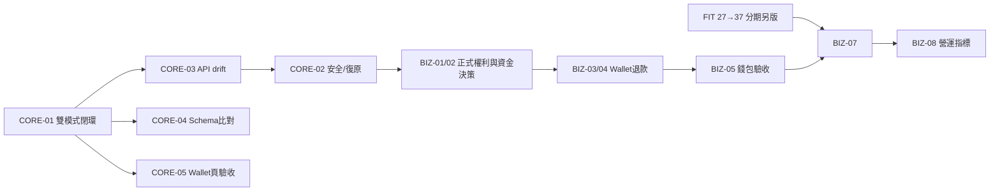

# KOHAMI 未完成規劃與驗收清單

> 靜態核對：2026-10-24，`main@0d54903e`。這是「尚未完成、尚未證明、需另案選用」的執行清單，**不重新定義已採政策**。原始 tickets：[kohami 01–38](../issues/kohami/)、[member-wallet 01–06](../issues/member-wallet/)、[production-launch/01](../issues/production-launch/01-go-live-readiness.md)；驗收依來源與最新程式碼，不因 checklist 的歷史 PASS 判斷最新部署正常。**本輪不執行付款、不修改 DB。**

## P0：先讓全流程可靠運作（核心與安全）

| ID | 未完成／待驗 | 前置依賴 | 要做的事 | 可驗收結果 |
|---|---|---|---|---|
| CORE-01 | `kohami/26` 交付審查最後一項未打勾：輸入／輸出／事件／消費者一致性 | 08–24 既有實作、25 本機必要安全項、wallet/02–03 本機切片 | 依最新雙模式 Storefront 梳理登入、商品、SKU、cart、quote、checkout、wallet/card mock、Order、出貨、退貨、退款、報表之 source→state→SQL→response；建立切換與錯誤恢復矩陣 | 同一候選上模擬與 API mode 全流程皆無跨帳戶洩漏、錯價、二次扣抵；404/409/422/503 可重試或安全提示；具 PASS/FAIL + 版本/fixture |
| CORE-02 | `kohami/25` 全票仍 claimed（正式監測、備份、restore、RPO/RTO 未完成） | 已有 21/23/24 本機驗收 | 區分 local-security 子集與 production；完成商務安全告警/責任/保留、非正式資料的隔離還原與 cutoff reconciliation 排練；不要解封正式資料 | 受控失敗/告警與每一步 trace、完整 restore 核對，計算 RPO≤1h/RTO≤8h；99.9% 屬實際月觀測不能以 demo PASS 替代 |
| CORE-03 | API 規格與實作漂移：27 項 runtime contract 之外另有 26 項模組路由 | CORE-01 | 補齊額外 endpoint 的 requestBody、headers、query、cookies、response、錯誤碼，對齊 frontend demo mock、backend、OpenAPI 與程式 | 所有已掛載 53 個 endpoint 都能從一份 machine-readable runtime contract 追溯；測試各有授權、CSRF、冪等、版本、拒絕情境，文件清單與路由 diff=0 |
| CORE-04 | DDL 與 live DB schema 尚未由本次驗證 | CORE-01 | 在專用 `kohami_local` 只讀 introspection，核對 identity_access/commerce/ops、catalog tables、Wallet、Audit、migrations、PK/FK/index/grants | 同版本 schema 欄位完整 CSV/JSON metadata（不含個資或密碼）；與 [database-schema.md](database-schema.md) diff=0 或每個差異有 migration/決策 |
| CORE-05 | 最新會員錢包儲值頁與公開雙模式切換的跨層驗收 | CORE-01 | 對 `2026-10-24 #11/#12` 的流程補正常/錯誤/重試/切換；mock 前端與 API/SQL 分別走同一旅程；只用測試卡和 synthetic account | 模式切換後 session/cart/order 不串資料源；錢包儲值不是實收，驗證 card invalid、量限制、重放、不足額、同時請求無雙花，具 Playwright+SQL evidence |
| CORE-06 | 契約、schema、頁面狀態與 docs/README 歷史摘要不同步 | CORE-01～05 | 更新入口來源與 CI 漂移檢查，確保不要再把舊 `KohamiM0/demo_m0` 或 34 核心操作當完整現況 | 文件中的 commit/authority/驗收日與原始證據一致；每次變更可檢出 route-schema-doc drift |

## P1：真實商務、會員儲值與售後（目前不得開真金流）

| ID | 未完成／延後 | 前置 | 需實作或決策 | 驗收 |
|---|---|---|---|---|
| BIZ-01 | `kohami/07` 品牌／商家／商品來源與權利（4/4 未勾） | 營業主體與真商品授權證據 | 品牌與供應商、授權/退換/尺寸/品檢、金流商戶與商品來源建立可追溯審核表 | 每 SKU 有來源/成本/素材使用證據；未核准不可對外收款 |
| BIZ-02 | `member-wallet/01` 完整正式資金策略 needs-info | BIZ-01 | 擇定正式可信入金、支付通道、付款結果簽章/重送、资金覆核、退款原路、會計分類；每題至少兩方案與採用人 | Decision Record（含負責人/生效日）與 provider sandbox 事件矩陣，批准前 disable |
| BIZ-03 | `member-wallet/03` Outbox/confirmed consumer 未完成（4/5） | 已驗 wallet 同 SQL transaction；需先有消費者需求 | **Option A（推薦）**：沒有真正 consumer 時維持不建假 Outbox，驗收標 DEFERRED；Option B：若履約/通知要非同步，定義事件版本、consumer、重試、fencing、DLQ | A：明確 scope 决策與無隱含事件；B：crash/duplicate/ordering/rollback SQL+worker 驗證 |
| BIZ-04 | `member-wallet/04` 餘額退款/對帳/人工配送（0/4） | BIZ-02/03、kohami/20/21/23 | 支付來源與退款目的地鎖定；退款比例分攤、原 collection/ledger、unknown compensation、並行防超退；人工狀態/稽核與權限 | 入金→扣抵→退貨→退款→餘額/庫存/憑證同筆對帳；一筆退款只能入帳一次，unknown 不自動重發 |
| BIZ-05 | `member-wallet/05` 錢包完整驗收及復原（0/4） | BIZ-04、CORE-02、CORE-01 | 隔離 restore／帳本重算、所有 member scope / crash / reload / replay / multi-worker / device cases；異人接手 runbook | WALLET-AC01–10/適用 FUL-AC、真 API+SQL+browser 成功與拒絕證據全齊，真入金仍須另批 |
| BIZ-06 | `kohami/04/05` 正式 provider/物流/發票審核留白 | BIZ-01/02 | 現行 mock 票 resolved **僅 local 規格與 synthetic 接縫**；真 provider sandbox、配送 SLA、正式發票／退款憑證尚未驗 | provider callback 簽驗與回呼重播/逾時、物流狀態映射、法律合規審查，每個外部系統各有測試證據 |
| BIZ-07 | `production-launch/01` 上線條件全部待完成（0/7） | BIZ-01～06、CORE-02、`kohami/37` | 移除測試入口、環境與密鑰隔離、正式 TLS/CDN、合法素材、真商務回滾、監控/復原、人員與授權 | 完成逐項 go/no-go 證據並取得人工正式批准；未通過不可稱 production ready |
| BIZ-08 | `kohami/38` 長週期營運 SLA 證據未開始（0/6） | BIZ-07 正式啟用 | 量測月可用率 99.9%、配送/客服時程、對帳/演練、成本 | 有真實期間、版本、樣本、責任，不可用 lab 或本機 mock 取代 |

## P2：固定模特三視圖換裝（與核心商店解耦）

| Tickets | 狀態 | 完成定義與依賴 |
|---|---|---|
| `kohami/27` | 0/5 | 先取得合法素材/成本授權；一套角色+真 SKU 正/右/背、人工比例和遮擋審查、裝置性能量測；不得引入 AI 生圖或個人照片 |
| `kohami/28` | 0/5 | outfit/save/export 契約、權利範圍、asset version、API 正反案例；27 原型 |
| `kohami/29` | 0/5 | SKU→三視圖審核→首個可試穿旅程，禁用時商品仍可購買 |
| `kohami/30` | 0/5 | fitting session→checkout fallback、失敗不污染 cart/price |
| `kohami/31` | 0/4 | 權利撤銷、快取失效、素材停用、重放安全 |
| `kohami/32` | 0/5 | 用戶明確保存服裝搭配，版本生命週期、刪除/過期與可追溯 |
| `kohami/33` | 0/5 | 有權利授權的非本人素材 outfit 匯出，流量/存取管控 |
| `kohami/34` | 0/5 | 四組角色（女2男2）× S/M/L/XL，明示示意身形，不暗示準確測量 |
| `kohami/35` | 0/5 | SKU×服裝尺碼×角色相容性發布及缺圖 fallback |
| `kohami/36` | 0/6 | 轉換素材準確性、行動效能/記憶體/快取、失敗回退 |
| `kohami/37` | 0/5 | 逐一稽核 27–36 的權利/三視圖/資料/UI/品質後，人工決定是否啟用 |
| `kohami/38` | 0/6 | 正式營運 SLA（非換裝開發項），見 BIZ-08 |

## 需修正的歷史標示（不是重新做功能）

- `kohami/01–03,06` 的 resolved 是**政策/技術基線**；`08–24` 多數為 local mock/product implementation resolved；`12` 舊「guest checkout」票歷史 resolved，**目前新訂單已改會員限定**，無須重啟匿名結帳。
- `kohami/23`、`24` 本機 accepted，仍有正式保存、備份、field CWV、行動 VoiceOver 等 deferred；不要將其解讀為正式 SLA。
- `member-wallet/02` synthetic credit + read accepted，不代表正式實付充值；`03` 現狀部分 complete + Open Acceptance。
- 任何任務以 `docs/todo/confuse.md` 先確認差異，避免修回過時政策。

## 執行順序與完成包

每項 PR 附：target commit、變更來源、授權與 impact、正反 API cases、SQL/Playwright/Release 證據、rollback；未實際跑的項目標 NOT_RUN，不要標 PASS。
